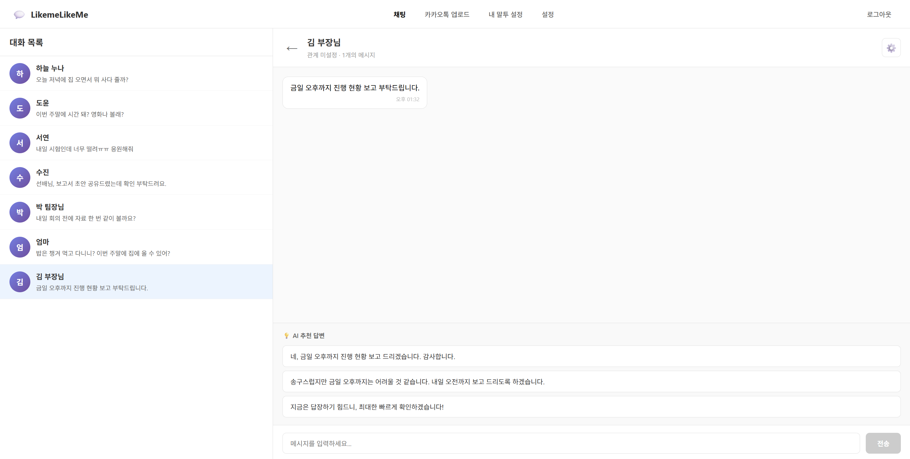
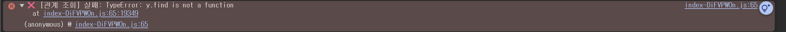
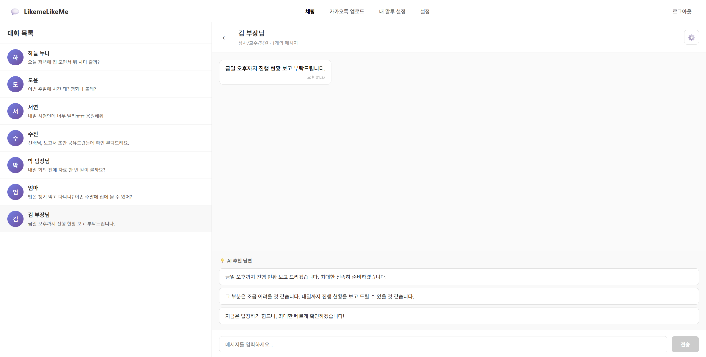

# [LikemeLikeMe] 확인하지 않은 화면에서 터진 버그 - Caddy 라우팅과 브라우저 캐시

## 배경

LikemeLikeMe는 캡스톤디자인2 수업에서 팀원들과 만든, 사용자의 말투를 참고해 답장을 만들어 주는 AI 서비스다. 프로젝트 소개는 [README](../../README.md)에 기록해 두었다.

캡스톤이 끝난 뒤 혼자 다시 열어 서버에 올렸다. 서버에서는 화면과 API를 하나의 주소로 묶기로 했다. Caddy가 화면 파일을 내려 주고, `/auth`나 `/llm` 같은 API 경로는 api 컨테이너로 넘겨 주는 구조다. HTTPS 인증서도 Caddy가 자동으로 받아 오게 했다. nginx 대신 Caddy를 쓴 것은 인증서 발급과 갱신까지 설정 몇 줄로 맡길 수 있어서였다.

개발 모드에서는 화면이 `localhost:3000`의 백엔드를 직접 호출했기 때문에 이런 경로 목록이 필요 없었다. 서버와 같은 구조는 로컬에서 `docker compose up`으로 띄워 로그인과 추천 답변, 카카오톡 업로드까지 확인했다. 채팅 화면의 관계 표시는 따로 확인해 보지 않았다.

같은 구조이니 서버에서도 문제없이 작동할 것이라고 생각했다.

하지만 서버에서 화면을 열고 상대를 고르자 헤더에 "관계 미설정"이 떴다. 고친 뒤에도 내 브라우저에서만 같은 증상이 남았다. 이 글은 그 두 가지에 대한 기록이다.

## 문제 1 — 화면이 "관계 미설정"이라고 말했다

서버에 올린 화면에서 가상 상대를 골라 AI 추천 답변이 나오는 것까지 확인했다. 추천은 잘 생성됐다.
그런데 이때 캡처해 둔 화면을 다시 보다가, 상대와의 관계를 DB에 올바르게 넣어 두었는데도 채팅 헤더에 "관계 미설정"으로 적혀 있는 것을 발견했다.



DB에는 각기 다른 관계 7개가 들어 있었는데도, 모든 대화 상대의 헤더는 "관계 미설정"이었다.

먼저 화면 쪽 코드를 확인했다. 채팅 화면은 `GET /relationships`로 관계 목록을 받아 와서, 그중에서 지금 상대의 관계를 `.find()`로 찾는다. 응답이 목록이 아니면 이 단계에서 오류가 나고, 관계가 비어 있는 채로 남아 헤더에 "관계 미설정"이 표시되는 구조였다.

그래서 서버의 `/relationships`를 클로드 코드와 직접 호출해 보았다. 응답은 JSON이 아니라 HTML이었다. 상태 코드는 `200`인데 `Content-Type`이 `text/html`이었고, 응답한 서버는 Caddy였다. API가 아니라 화면 파일(`index.html`)이 돌아온 것이었다.

Caddyfile을 열어 보니 API로 넘길 경로 목록에 `/relationships/*`가 있었다. 이것이 왜 `/relationships`를 못 잡는지는 Caddy 문서를 읽고 나서야 알게 되었다. Caddy는 경로를 기본적으로 정확히 일치할 때만 매칭하고, `/foo/*`는 `/foo` 자체와는 일치하지 않는다고 한다([Caddy 문서](https://caddyserver.com/docs/caddyfile/matchers)). 관계 목록 조회와 생성(`GET`, `POST /relationships`)이 바로 그 정확한 경로를 쓰고 있었다.

목록에 걸리지 않은 요청은 조건이 없는 마지막 `handle` 블록으로 넘어갔다([handle 문서](https://caddyserver.com/docs/caddyfile/directives/handle)). 거기에는 `try_files {path} /index.html`이 있었다. `try_files`는 요청 경로를 목록에서 처음 존재하는 파일로 바꿔 주는데([try_files 문서](https://caddyserver.com/docs/caddyfile/directives/try_files)), `/relationships`라는 파일은 없으니 `/index.html`이 돌아온 것으로 이해했다.

같은 설정을 임시 Caddy와 가짜 API 서버로 따로 띄워 확인해 보니 실제로 그랬다. 가짜 API는 어느 경로든 404로 답하게 해서, 404가 오면 API까지 간 것이고 200이 오면 화면 파일로 빠진 것이다.

```
/relationships        200  (화면 파일로 빠짐)
/relationships/abc    404  (API까지 도달)
/auth/login           404  (API까지 도달)
```

로컬 `docker compose`도 같은 Caddyfile을 쓰니, 로컬에서도 같은 일이 있었을 것으로 보인다.

해결 방법은 경로 목록에 `/relationships`를 하나 더 적는 것이었다.

```
@api path /auth/* /llm/* /telegram/* /relationships /relationships/* /kakao/* /test-db
```

위 코드와 같이 `/relationships`와 `/relationships/*`를 나란히 적었다.
Caddy 문서에는 이 둘을 한 번에 잡는 권장 방식이 따로 나와 있지 않았다.
대신 앞에서 쓴 임시 Caddy에 같은 목록을 넣어 보니 `/relationships`가 API까지 도달했다.

고친 Caddyfile은 서버에서 쓰는 것과 같은 버전의 Caddy 이미지로 문법부터 검증했다(`Valid configuration`).
Caddyfile은 웹 이미지 안에 들어 있어서 api와 embedding은 그대로 두고 web 이미지만 다시 빌드해 서버에 올렸다.

다시 올린 뒤 서버의 `/relationships`를 호출해 보니 이번에는 JSON이 응답으로 왔다.
로그인하지 않으면 `401`, 로그인하면 관계 7개가 담긴 목록이었다.

## 문제 2 — 고쳤는데도 내 브라우저에서만 안 고쳐졌다

Caddyfile을 고쳐 서버에 올렸으니 화면도 바로 고쳐졌을 것이라고 생각했다. 그런데 브라우저를 새로고침해도 헤더는 여전히 "관계 미설정"이었다.
서버의 `/relationships`는 클로드 코드로 다시 호출해 보아도 JSON을 돌려주고 있었다. 서버는 JSON을 주는데, 화면에는 그 데이터가 반영되지 않았다.

그 이유를 확인하기 위해 개발자 도구(F12)의 콘솔 로그를 열어 보니, 아래와 같은 오류가 찍혀 있었다.



`y.find is not a function`. 앞에서 본 `.find()`가 목록이 아닌 값에 쓰이고 있다는 뜻으로 읽혔다. 그 값이 무엇인지, 서버는 이미 목록을 주는데 왜 아직도 목록이 아닌지는 알 수 없었다.

클로드 코드가 시크릿 창에서 같은 주소를 열어 보라고 했다. 열어 보니 같은 서버, 같은 화면인데 헤더에 관계가 정상으로 표시되어 있었다.



서버가 같은데 창에 따라 결과가 다르다면, 문제가 캐시에 있다고 짐작했다. 서버를 고치기 전에 `/relationships`가 돌려준 HTML 응답을 브라우저가 캐시에 저장해 두고, 그것을 계속 쓰고 있는 것은 아닐까 하는 생각이었다.

당시 서버가 돌려준 HTML 응답의 헤더는 아래와 같다.

```
Content-Type: text/html; charset=utf-8
Etag: "dlal0p8ik7pcag"
Last-Modified: Wed, 09 Sep 2026 06:46:15 GMT
```

`Last-Modified`와 `ETag`는 있는데 `Cache-Control`이 없었다. [MDN 문서](https://developer.mozilla.org/en-US/docs/Web/HTTP/Guides/Caching)에는 `Cache-Control`이 없어도 응답이 저장되고 재사용될 수 있다고 나와 있다. 문서는 HTTP가 "가능한 한 많이 캐시하도록 설계되어 있다"고 설명하고, 이런 암묵적인 캐시를 **휴리스틱 캐시**라고 부른다. 그래서 모든 응답에 `Cache-Control`을 명시하는 편이 좋다고도 한다.

그렇다면 서버를 고친 뒤에도 브라우저는 서버에 다시 묻지 않고, 저장해 둔 HTML을 `/relationships`의 응답으로 쓰고 있었던 것으로 이해했다. 다만 브라우저에 저장된 응답을 직접 열어서 확인한 것은 아니다. 시크릿 창에서만 정상이었다는 점과 응답 헤더, 문서 내용을 이어 붙인 추정이다.

해결 방법은 서버가 모든 응답에 `Cache-Control`을 직접 붙이는 것이었다. Caddyfile에서 API 응답과 화면 파일 응답에 서로 다른 값을 주었다.

```
handle @api {
    header Cache-Control "no-store"
    reverse_proxy api:3000
}

handle {
    header Cache-Control "no-cache"
    root * /srv
    try_files {path} /index.html
    file_server
}
```

두 값은 이름이 비슷하지만 뜻이 다르다. MDN 문서에서 읽은 내용은 이렇다.

- [`no-store`](https://developer.mozilla.org/en-US/docs/Web/HTTP/Reference/Headers/Cache-Control): 어떤 캐시에도 응답을 저장하지 말라는 뜻이다.
- `no-cache`: 응답을 저장해도 되지만, 다시 쓰기 전에 매번 서버에 확인하라는 뜻이다. "캐시하지 마라"는 뜻이 아니라는 설명도 따로 있었다.

API 응답에는 `no-store`를 주었다. 이번처럼 잘못된 응답이 브라우저에 남으면 곤란하다고 보고, 아예 저장하지 않게 했다.

화면 파일에는 `no-cache`를 주었다. 저장은 하되 쓰기 전에 서버에 확인하게 하면, 파일이 바뀌지 않았을 때는 `304`로 본문 없이 가볍게 끝난다.

고친 Caddyfile은 이번에도 문법을 검증하고, web 이미지를 다시 빌드해 서버에 올렸다. 다시 올린 뒤 서버의 응답 헤더를 확인했다. API 응답에는 `Cache-Control: no-store`가, 화면 파일에는 `Cache-Control: no-cache`가 붙어 있었다.

다만 이 헤더는 앞으로 받는 응답에만 적용된다. MDN 문서에도 `no-store`는 응답이 저장되는 것을 막을 뿐, 같은 주소로 이미 저장된 응답을 지우지는 않는다고 나와 있다.

그래서 내 일반 창의 캐시가 정상으로 돌아왔는지는 확인하지 않았다. 시크릿 창에서 화면 기능과 콘솔 오류 로그를 확인하는 정도로 마쳤다. 이 일은 잘못된 응답을 받았던 내 브라우저에만 남은 문제라서, 브라우저를 바꿔 빠르게 확인하는 편이 이득이라고 생각했다. 앞으로 나가는 응답에는 `Cache-Control`이 붙으니 실제 사용에서는 같은 문제가 생기지 않을 것으로 보고, 더 깊게 확인하지는 않았다.

## 마무리

이번에 겪은 일로 알게 된 것은 오류가 항상 오류처럼 보이지는 않는다는 점이었다. `/relationships`는 API가 아니라 화면 파일을 `200`으로 돌려주고 있어서, 응답만 보면 정상이었다. 어긋난 곳은 그 응답을 받아 쓰는 화면 쪽이었다.

이 문제가 늦게 드러난 것은 내가 확인한 화면이 로그인과 추천 답변, 카카오톡 업로드까지였기 때문이다. 관계 표시는 확인 범위 밖에 있어서 가려져 있었다. 다음에는 서버에 올린 뒤 어느 화면과 기능을 확인할지 목록을 먼저 만들어 두고, 올린 뒤 그 목록대로 확인하고자 한다. 목록은 배포 문서의 검증 절차에 먼저 적어 두려고 한다.

고쳤는데도 내 브라우저에서는 그대로였던 일은, 서버를 고치는 것과 브라우저에 남은 응답이 별개라는 것을 알려 주었다. 이번에는 응답마다 `Cache-Control`을 직접 붙여 두었지만, 앞으로 새 응답을 추가할 때도 같은 방식으로 명시해야 한다는 것을 기억하려고 한다.
