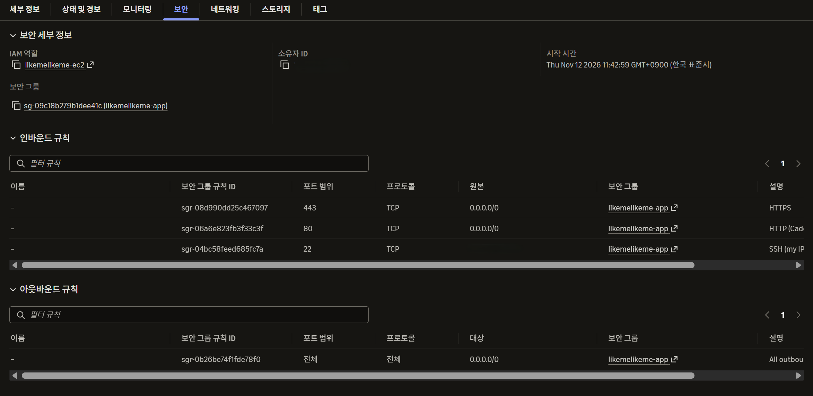
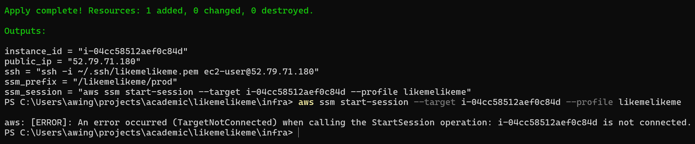
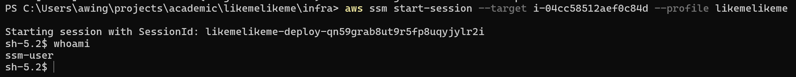
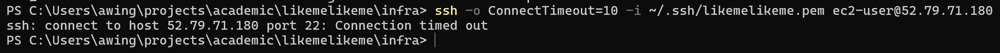
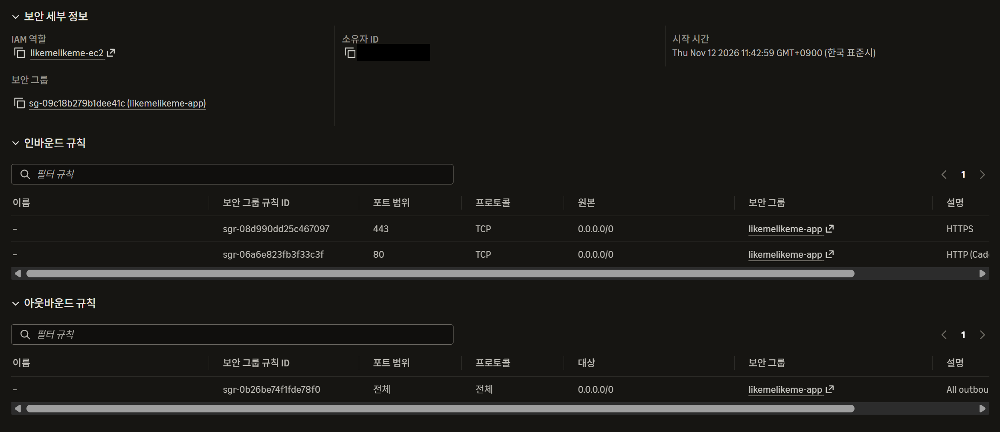

# [LikemeLikeMe] 22번 포트를 닫기까지 - SSH 타임아웃에서 SSM Session Manager 전환까지

## 배경

LikemeLikeMe는 캡스톤디자인2 수업에서 팀원들과 만든, 사용자의 말투를 참고해 답장을 만들어 주는 AI 서비스다. 프로젝트 소개는 [README](../../README.md)에 기록해 두었다.

캡스톤이 끝난 뒤 이 프로젝트를 혼자 다시 열어 AWS에 올렸다. 서버는 Terraform으로 EC2 한 대를 만들었고, 서버에 들어가는 방법은 SSH로 정했다.
가장 익숙했고, 블로그와 공식 문서 같은 자료도 많아서 서버 운영 중 문제가 생겨도 해결 방법을 찾기 쉬울 것이라고 생각했다. 또 SSH는 키와 22번 포트만 열려 있으면 바로 쓸 수 있고, 서버에 따로 에이전트나 권한을 준비하지 않아도 되어서 단순했다.
SSM Session Manager는 써 본 적이 없었다. 클로드 코드가 배포를 마친 뒤 SSH 대신 SSM으로 바꾸는 것을 개선 과제로 제안해서, 먼저 SSH로 올리고 나중에 바꾸기로 했다. 서버를 올려 확인하는 일만 보면 SSH로도 충분해 보였지만, 배포에서 끝내지 않고 22번 포트를 열어 둔 상태를 개선해서 바꾸기 전과 후를 남기고 싶었다.

보안 그룹은 22번 포트로 들어오는 접속을 내 공인 IP 하나(/32)에서만 허용하게 했다. 접속에는 키 파일(`.pem`)을 썼다. 서버가 한 대뿐인 서비스라서 이 정도면 충분하다고 생각했다.



하지만 이 설정에는 전제가 하나 있었다. 내 공인 IP가 바뀌지 않는다는 것이다. 이 글은 그 전제가 깨져서 서버에 들어갈 수 없게 된 일과, 그 뒤 접속 방식을 바꾼 과정에 대한 기록이다.

## 문제 1 — 강의실을 옮기자 서버에 들어갈 수 없었다

처음에는 SSH 접속에 문제가 없었다. 서버를 만든 뒤 학교 강의실에서 접속해, 시크릿을 받아 `.env`를 만들고 컨테이너를 올리는 작업까지 SSH로 진행했다.

한 시간쯤 뒤 다른 건물의 강의실로 옮겨 노트북을 열고 같은 명령으로 접속하자, 아무 응답 없이 `Connection timed out`이 떴다. 몇 번을 다시 해도 같았다.

SSH에서 키가 맞지 않으면 보통 `Permission denied`처럼 서버가 접속을 거절했다는 메시지가 나온다. `timed out`은 그런 응답조차 없는 경우라서, 인증 문제가 아니라 연결 자체가 안 되는 문제로 보였다.

먼저 와이파이 같은 내 쪽 네트워크를 점검했지만 이상이 없었다. 이전 강의실과 같은 와이파이였다. 클로드 코드로 확인하니 인스턴스는 실행 중이었고, 같은 서버의 웹(443)은 정상으로 응답했다. 22번만 응답이 없다면 요청이 서버까지 닿지 못하고 있다고 짐작할 수 있었다.

보안 그룹의 22번이 허용하는 IP와 지금 쓰는 PC의 공인 IP를 비교해 보니 끝자리만 달랐다. 같은 와이파이였지만 건물이 달라지면서 공인 IP가 바뀐 것이었다. 건물마다 인터넷으로 나가는 주소가 다른 것으로 짐작하고, 학교 네트워크 구성은 확인하지 못했다.

고정된 것은 서버 쪽이었고, 접속하는 쪽은 들고 다니는 노트북이었다. 위치가 바뀌면 막힐 수 있다는 것은 계획에도 적어 두었고, 그때는 허용 IP를 고치면 된다고 생각했다. 하지만 같은 와이파이를 쓰는데도 한 시간 만에 막힐 수 있다는 점까지는 신경 쓰지 못했다.

허용 IP를 새 값으로 바꿔 `terraform apply`를 다시 실행하니 접속은 복구됐다. 하지만 같은 일이 또 생기면 그때마다 고쳐야 했고, 22번 포트와 키 파일을 계속 관리해야 하는 점이 번거로웠다.

## 해결 — IP를 맞추는 대신 접속 방식을 바꿨다

접속은 복구됐지만 같은 일이 또 생길 수 있어서, 계획해 둔 개선을 앞당기기로 했다. 위치가 바뀌면 접속이 안 되는 것, 키 파일을 관리해야 하는 것, 22번 포트가 열려 있는 것을 한 번에 없앨 수 있는 방법이 SSM Session Manager였다.

AWS 문서는 Session Manager를 인바운드 포트를 열지 않고도 서버를 관리하는 방법으로 설명한다. 22번 같은 포트를 닫고, SSH 키와 배스천 호스트를 관리하지 않아도 된다고 한다([Session Manager 문서](https://docs.aws.amazon.com/systems-manager/latest/userguide/session-manager.html)). 접속할 수 있는 사람도 IP나 키가 아니라 IAM 정책으로 정한다.

다만 접속 수단을 바꾸다 잘못되면 서버에 들어갈 방법이 사라질 수 있었다. 그래서 두 단계로 나누었다.

1. SSM에 필요한 권한을 서버에 연결하고, 에이전트가 연결되어 `start-session`으로 들어가지는지 확인한다. 이때 22번은 그대로 둔다.
2. 접속이 확인되면 보안 그룹에서 22번 규칙을 지운다.

권한은 AWS 관리형 정책 `AmazonSSMManagedInstanceCore`를 연결했다. AWS 문서는 이 정책, 또는 이에 상응하는 사용자 정의 정책을 연결하도록 안내하고 있어 이를 따랐다([문제 해결 문서](https://docs.aws.amazon.com/systems-manager/latest/userguide/session-manager-troubleshooting.html)). 변경은 Terraform으로 반영했다.

이 글에서 막힌 곳은 1단계의 마지막 확인인 `start-session`이었다.

## 문제 2 — SSM으로도 들어가지지 않았다

1단계로 권한을 연결하는 `terraform apply`는 `1 added`로 끝났다. 그런데 `aws ssm start-session`을 실행하자 접속되지 않고 `TargetNotConnected`가 떴다.



오류 이름만으로는 무엇이 빠졌는지 알 수 없었다. AWS 문서는 이 오류가 에이전트가 실행되지 않았을 때, 인스턴스 프로파일이 없거나 권한이 부족할 때 등 여러 경우에 난다고 설명한다([문제 해결 문서](https://docs.aws.amazon.com/systems-manager/latest/userguide/session-manager-troubleshooting.html)). 그래서 서버의 에이전트부터 확인했다. 22번을 아직 닫지 않아서 SSH로 서버에 들어가 볼 수 있었다.

에이전트는 `apply` 전에 이미 서버에 설치해 둔 상태였다. 이 서버에는 처음에 에이전트(`amazon-ssm-agent`)가 없어서, 22번이 열려 있을 때 SSH로 들어가 설치했다. AWS 문서에는 Amazon Linux 2023이 에이전트가 미리 설치된 AMI 목록에 있지만, 만들어진 시점에 따라 없을 수 있다고 되어 있다([미리 설치된 AMI 문서](https://docs.aws.amazon.com/systems-manager/latest/userguide/ami-preinstalled-agent.html)). 이 서버에 에이전트가 없었던 구체적인 원인은 확인하지 못했다. 새로 만드는 서버에서는 같은 일이 없도록 `user-data.sh`에 설치를 추가했다.

에이전트는 실행 중(`active`)이었지만 SSM에는 등록되어 있지 않았다. 에이전트 로그를 열어 보니 권한 오류가 찍혀 있었다.

```
WARN EC2RoleProvider Failed to connect to Systems Manager with instance profile role credentials. … AccessDeniedException …
INFO [CredentialRefresher] Sleeping for 28m55s before retrying retrieve credentials
```

에이전트를 설치해 시작한 시점에는 서버의 역할에 아직 SSM 권한이 없었다. 에이전트는 권한 오류를 받고 다음 시도를 약 29분 뒤로 미룬 것이다. 권한은 그 뒤에 연결됐지만, 에이전트는 로그상 그 대기 시간이 끝나기를 기다리고 있었다.

해결은 에이전트를 재시작하는 것이었다. `sudo systemctl restart amazon-ssm-agent`로 한 번 재시작했지만 같은 권한 오류가 났다. 권한이 아직 반영되지 않은 것으로 보였다. 2분쯤 뒤 한 번 더 재시작하자 몇 초 만에 연결됐고, SSM에서 서버가 `Online`으로 보였다.

## 검증 — 접속은 되고, 22번은 닫혔는가

확인할 것은 두 가지였다. SSM으로 서버에 들어갈 수 있는지, 그리고 22번을 닫은 뒤에도 서버를 다룰 수 있는지였다.

먼저 `aws ssm start-session`으로 접속하자 SSH 키 없이 서버 안으로 들어갔고, `whoami`는 `ssm-user`였다.



접속이 확인된 뒤 허용 IP 값을 비우고 `terraform apply`를 실행했다. 결과는 `0 added, 1 changed, 0 destroyed`로, 서버는 그대로 두고 보안 그룹만 바뀌었다. 같은 명령을 다시 실행하자 `No changes. Your infrastructure matches the configuration.`이 나와 코드와 실제 인프라가 일치했다.

그다음 예전처럼 SSH로 접속을 시도했다. `Connection timed out`이 떴다. 문제 1과 같은 메시지지만, 이번에는 22번이 닫혀서 생긴 의도한 결과다.



보안 그룹의 인바운드 규칙은 세 줄(22·80·443)에서 두 줄(80·443)이 되었다. 배경에서 본 사진과 비교하면 22번 줄이 사라졌다.



마지막으로 22번이 닫힌 상태에서 서버를 다룰 수 있는지 확인했다. 마이그레이션 수정을 반영한 재배포(이미지 태그 변경, 컨테이너 재생성, api 로그 확인)를 모두 `aws ssm send-command`로 실행했고, 상태는 `Success`였다.

## 마무리

이번 일은 서버에 접속하는 방식도 설계의 대상이라는 점을 다시 확인하는 계기가 되었다. 서버를 올릴 때는 서버 쪽 설정에 집중했는데, 막힌 것은 접속하는 노트북의 위치가 바뀌었을 때였다. 허용 IP를 고치면 당장은 해결됐지만 같은 일이 되풀이될 구조여서, 접속 방식을 바꾸기로 했다.

접속 수단을 바꿀 때는 새 수단을 먼저 확인하고 이전 수단은 마지막에 닫는 순서가 도움이 됐다. 22번을 열어 둔 채 1단계를 진행해서, SSM이 연결되지 않았을 때 SSH로 들어가 에이전트 로그를 볼 수 있었다. 에이전트가 대기에 빠진 것은 권한을 연결하기 전에 에이전트를 먼저 시작했기 때문이었다. 권한을 먼저 연결하고 에이전트를 시작했다면 이 대기는 생기지 않았을 가능성이 높다.

남은 것도 있다. `user-data.sh`에 에이전트 설치를 추가했지만, 서버를 철거한 뒤 다시 만들지 않아서 새 서버에서 동작하는지는 확인하지 못했다. 권한도 AWS 관리형 정책을 그대로 쓰고 있어서, 필요한 권한만 담은 정책으로 줄이는 것은 후속 과제로 남겨 둔다.
