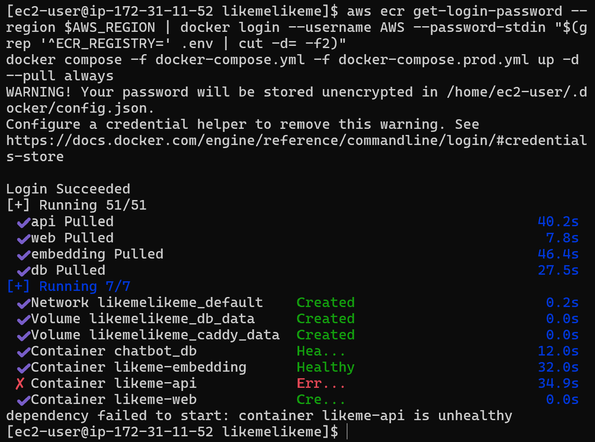
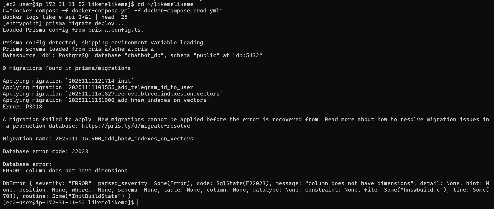
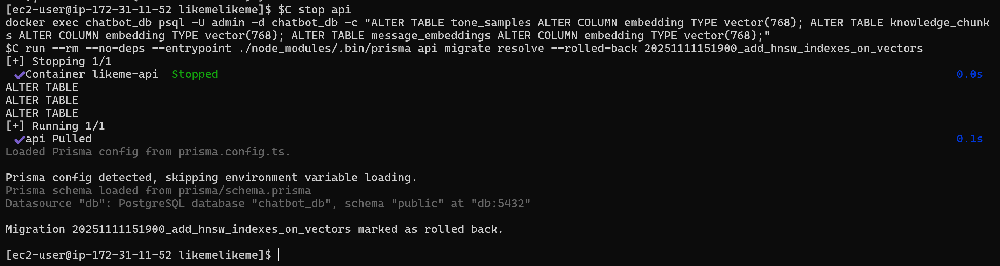
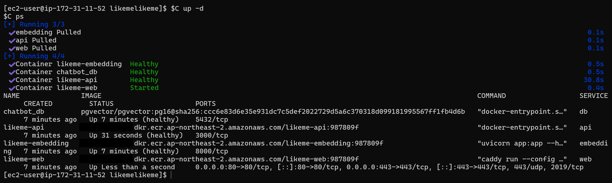

# [LikemeLikeMe] 로컬에서 가려져 있던 것 - 깨끗한 DB에서 만난 Prisma 마이그레이션 오류

<!--
작성 규칙 (완성 후 이 주석 블록은 삭제)
- 이 파일은 글 A(마이그레이션 이력). 문제 2·3(라우팅·캐시)은 draft-routing-cache.md 로 분리.
- 번호(NN-)와 파일명은 글 순서를 정할 때 바꾼다.
- 한 번에 한 섹션만 초안 → 수정 → 최종본 확정 후 다음 섹션.
- 구조: H2 배경 / 문제 / 해결 / 검증 / 마무리. 소제목은 필요한 곳에만.
- 문체: "~다" 체, 배우는 입장의 경험 서술. 단정·훈계 투 지양.
- 이미지는 ../evidence/ 의 마스킹된 사본만 사용.
- 사실의 원자료: docs/REFACTORING_LOG.md, docs/evidence/README.md
-->

## 배경

LikemeLikeMe는 캡스톤디자인2 수업에서 팀원들과 만든, 사용자의 말투를 참고해 답장을 만들어 주는 AI 서비스다. 프로젝트 소개는 [README](../../README.md)에 기록해 두었다.

캡스톤이 끝난 뒤 이 프로젝트를 혼자 다시 열었다. 이번 목표는 말투 성능이 아니라, 이 서비스를 실제로 서버에 올려서 돌아가는 상태로 만드는 것이었다. 순서는 Docker로 묶고, Docker Compose로 여러 컨테이너를 엮은 뒤 AWS에 올리는 것이었다.

로컬에서는 `docker compose up`으로 서비스 네 개가 모두 떴다. 로그인, 추천 답변 생성, 카카오톡 파일 업로드까지 확인했다.
그다음 Terraform으로 EC2를 만들고, ECR에 올린 이미지를 시크릿과 함께 서버에서 받아 실행했다.

이미 Docker로 컨테이너를 모두 엮어 두었고 로컬에서도 잘 돌아갔으니, 배포 환경에서도 문제없이 작동할 것이라고 생각했다.

하지만 서버를 처음 띄우자 api 컨테이너가 시작되지 못했다.
발목을 잡은 것은 데이터베이스 마이그레이션이었고, 이 글은 그 문제에 대한 기록이다.

## 문제 — 깨끗한 DB에서 마이그레이션이 처음부터 재생되지 않았다

서버에서 `docker compose -f docker-compose.yml -f docker-compose.prod.yml up -d --pull always`를 실행했다. 이미지 네 개가 모두 내려받아졌다.
그런데 마지막에 api 컨테이너가 `unhealthy`라는 메시지와 함께, 이 컨테이너를 기다리던 서비스가 시작되지 못했다는 오류가 떴다.



ECR은 처음 써 보는 입장이라, 이미지만 제대로 올라가 있으면 별다른 이상 없이 배포될 거라고 생각했다. 그래서 오류를 보고도 당장 짐작 가는 원인이 없었다.

다음 단계로 넘어가기 전에 먼저 로그를 직접 확인해 보기로 했다. 그리고 로그를 확인한 뒤 클로드 코드를 이용해서 원인을 찾고 해결하고자 했다.

로그를 열어 보니, api 컨테이너가 시작하면서 실행하는 `prisma migrate deploy`가 마이그레이션 네 번째에서 실패하고 있었다.

```
Applying migration `20251111151900_add_hnsw_indexes_on_vectors`
Error: P3018
ERROR: column does not have dimensions
```



"컬럼에 차원이 없다"는 말이었다. 클로드 코드와 마이그레이션 파일을 순서대로 열어 보았다.

1. 가장 처음 마이그레이션(`init`)은 임베딩 컬럼을 차원 없는 `vector`로 만들고 있었다.
2. 바로 뒤의 마이그레이션이 이 컬럼에 HNSW 인덱스를 만드는데, 차원이 없는 컬럼에는 이 인덱스를 만들 수 없었다.
3. 컬럼 차원을 지정하는 마이그레이션(`embedding_dim_768`)은 이보다 뒤에 있었다.

차원을 정해 주기 전에 인덱스부터 만들려다 막힌 것이었다. 이 오류는 pgvector 문서에도 나와 있었다. 인덱스를 만들 컬럼에는 차원이 정의돼 있어야 하고, 차원 없이 `vector`로만 선언한 컬럼에 인덱스를 만들면 같은 오류가 난다는 내용이었다([Microsoft Learn](https://learn.microsoft.com/en-us/azure/postgresql/extensions/how-to-optimize-performance-pgvector)).

컨테이너가 계속 재시작한 이유는 따로 있었다. 한 번 실패한 마이그레이션이 남아 있으면 Prisma가 이후 시도를 모두 막아서(`P3009`), 재시작해도 같은 자리에서 멈췄다.

그런데 로컬에서는 이 문제를 한 번도 보지 못했다. 로컬 DB에서는 차원이 마이그레이션 이력과 별개로 이미 적용돼 있었기 때문일 것으로 추정한다.

다만 단서는 이미 프로젝트 안에 있었다. 9월에 임베딩 모델을 바꾸며 만든 `embedding_dim_768` 마이그레이션의 첫머리에 이런 주석이 있었다.

```
-- 이 파일은 psql 로 직접 적용 후 `prisma migrate resolve --applied` 로 이력에 기록한다
-- (기존 마이그레이션 이력이 shadow DB 재생 불가라 `migrate dev` 사용 불가).
```

첫 줄은 이 마이그레이션을 `psql`로 직접 적용한 뒤 이력에만 기록했다는 뜻이다. 로컬 DB가 이력 밖에서 바뀐 적이 있다는 점에서 앞의 추정과 맞는 단서다.

그때 무슨 뜻으로 적었는지는 기억나지 않는다. 그 주석에 대한 답은 Prisma 문서에서 확인할 수 있었다. shadow DB는 `prisma migrate dev`가 기존 마이그레이션 이력을 임시 DB에 처음부터 다시 적용해 보는 데 쓰는 DB였다([Prisma 문서](https://www.prisma.io/docs/orm/prisma-migrate/workflows/shadow-database)).

그렇다면 "재생 불가"는 이력을 처음부터 적용할 수 없다는 뜻이었을 것이다. 이번에 겪은 문제와 같은 원인이었을 가능성도 있다. 다만 그때 어떤 오류가 났는지는 남아 있지 않아서 확정할 수는 없다.

## 해결

먼저 서버부터 살려야 했다. 서버의 DB는 비어 있어서 잃을 데이터는 없었다. api를 멈추고, 세 테이블(`tone_samples`, `knowledge_chunks`, `message_embeddings`)의 `embedding` 컬럼에 차원을 직접 지정했다. 그다음 Prisma가 실패로 기록해 둔 마이그레이션을 `migrate resolve --rolled-back`으로 풀어 주었다. 다시 올리자 남은 마이그레이션이 이어서 적용되고 api가 올라왔다.



하지만 서버만 고치면 같은 문제가 남는다고 생각했다. 새 환경에서 이력을 처음부터 적용하면 같은 자리에서 또 실패할 것이었다. 그래서 이력 자체를 고치기로 했다.

다만 이력을 손보는 것과 이미 적용된 마이그레이션 파일을 고치는 것은 별개의 일이었다. 이미 적용된 파일은 수정하지 않았다. Prisma는 `_prisma_migrations` 테이블의 `checksum` 값으로 적용된 마이그레이션 파일이 바뀌었는지 확인한다([shadow database 문서](https://www.prisma.io/docs/orm/prisma-migrate/workflows/shadow-database)). 또 Prisma 문서는 이미 적용된 마이그레이션을 고치거나 지우지 않는 것이 일반적이라고 설명한다([migration histories 문서](https://www.prisma.io/docs/orm/prisma-migrate/understanding-prisma-migrate/migration-histories)). 로컬 DB에는 네 번째 마이그레이션이 이미 적용된 상태일 가능성이 높아서, 그 파일을 고치면 로컬 쪽에서 변경으로 감지될 수 있다고 추정했다.

대신 HNSW 인덱스를 만드는 마이그레이션 바로 앞(`20251111151850`)에 새 마이그레이션을 끼워 넣었다. 차원이 없는 컬럼만 `vector(768)`로 바꾸고, 이미 차원이 있는 DB에서는 아무것도 하지 않게 만들었다. 차원이 없는지는 컬럼 정보의 `atttypmod`가 `-1`인지로 구분했다.

```sql
DO $$
DECLARE tbl text;
BEGIN
  FOREACH tbl IN ARRAY ARRAY['tone_samples', 'knowledge_chunks', 'message_embeddings'] LOOP
    IF (SELECT a.atttypmod FROM pg_attribute a
        WHERE a.attrelid = format('public.%I', tbl)::regclass
          AND a.attname = 'embedding') = -1 THEN
      EXECUTE format('ALTER TABLE public.%I ALTER COLUMN embedding TYPE vector(768)', tbl);
    END IF;
  END LOOP;
END $$;
```

## 검증 — 빈 DB와 기존 DB, 두 경로로

서버를 복구한 직후에는 서비스 네 개가 모두 정상으로 올라와 있었다.



새 마이그레이션은 클로드 코드로 임시 pgvector DB를 띄워서 두 가지 경우를 시험했다. 완전히 빈 DB에서는 마이그레이션 10개가 처음부터 끝까지 통과했다. 서버와 같은 상태, 즉 컬럼 차원을 직접 지정하고 실패 기록을 푼 DB에서는 새 마이그레이션만 추가로 적용됐다.

새 마이그레이션을 빼고 같은 빈 DB에 적용하면 서버에서 봤던 `P3018`이 그대로 재현됐다. 원인을 제대로 짚었다는 확인이기도 했다.

이 수정을 서버에 배포한 뒤에는 api 로그에서 `All migrations have been successfully applied`를 확인했고, 세 컬럼도 `vector(768)` 그대로였다.

## 마무리

이번에 겪은 일로 알게 된 것은 마이그레이션이 "지금 DB에서 돌아간다"와 "처음부터 돌아간다"는 서로 다른 문제라는 점이었다. 로컬 DB에서는 이미 지나온 길이라 매번 통과했고, 빈 DB에서는 처음 지나는 길이었다. 9월에 주석으로 남긴 "재생 불가"도 같은 신호였을 것이라는 생각이 든다.

다음에는 새 환경에 올리기 전에 빈 DB에 이력을 처음부터 적용해 보는 확인을 먼저 거치고, 그다음에 올리는 쪽으로 배포 루틴을 바꾸고자 한다. 서버에서 오류가 터진 뒤에 알게 되는 것이 아니라, 올리기 전에 미리 잡아내는 흐름이다.

지금 이 프로젝트에는 그 확인을 자동으로 돌려 주는 장치(CI)가 아직 없다. CI를 직접 설계하고 활용하는 역량을 키우는 것을 이 프로젝트의 후속 과제로 남겨 둔다.
