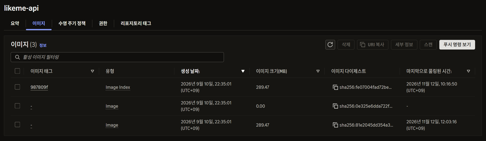

# ECR 이미지 인덱스와 스캔 오류

개인 학습 메모. 확인한 것과 못 한 것을 구분해서 적음.

## 증상

- ECR에 push한 이미지를 태그(`987809f`)로 기본 스캔하자 `UnsupportedImageTypeException`이 남.
- 콘솔의 이미지 목록에는 태그가 붙은 행 하나(유형 `Image Index`)와 태그 없는 `Image` 행 둘이 보였음. 하나는 크기가 0.00MB였음.

## 일반적으로는

- Docker 문서에 따르면 멀티 플랫폼 이미지는 매니페스트 목록(manifest list)이 플랫폼별 매니페스트 여러 개를 가리키는 구조임([Multi-platform builds](https://docs.docker.com/build/building/multi-platform/)).
- buildx는 빌드 출처를 증명하는 provenance attestation을 기본으로 이미지에 추가함. 증명은 이미지 인덱스에 붙고, 증명 매니페스트의 플랫폼은 `unknown/unknown`으로 표시됨([Build attestations](https://docs.docker.com/build/metadata/attestations/), [Image attestation storage](https://docs.docker.com/build/metadata/attestations/attestation-storage/)).
- ECR도 멀티 아키텍처 이미지를 매니페스트 목록으로 push하는 것을 지원함([Pushing a multi-architecture image to an Amazon ECR private repository](https://docs.aws.amazon.com/AmazonECR/latest/userguide/docker-push-multi-architecture-image.html)).

## 내 경우

- 빌드는 `docker buildx build --platform linux/amd64 … --push`였음. 플랫폼이 하나뿐인데도 ECR에는 인덱스가 올라갔음.
- 기본 증명 때문에 인덱스가 만들어진 것으로 **추정**함. 0.00MB 행이 증명 매니페스트로 보이지만 직접 열어 보지는 못함.
- 스캔 대상을 인덱스를 가리키는 태그가 아니라 amd64 이미지(289MB 행)의 digest로 바꾸자 스캔이 됨. 결과는 증거 41~44에 있음.

## 몰랐던 것 / 배운 것

- 플랫폼이 하나면 태그 하나가 이미지 하나라고 생각했음. 태그가 이미지 인덱스를 가리킬 수 있고, 그 밑에 이미지가 여러 개 있을 수 있음.
- 도구가 태그를 "이미지 하나"로 가정하는지, 인덱스도 받는지는 도구마다 다를 수 있음. 비슷한 오류가 나면 대상이 이미지인지 인덱스인지부터 확인해 볼 것.

## 확인한 것 / 못 한 것

- 확인함: 위 Docker·ECR 문서의 문장들, 내 환경에서 태그로 스캔은 실패하고 digest로는 성공한 것.
- 못 함: ECR 스캔 문서 두 곳(기본 스캔, 소프트웨어 취약점 스캔)에서 인덱스 스캔 제한이나 `UnsupportedImageTypeException`에 대한 설명을 찾지 못함. "ECR 스캔이 인덱스를 지원하지 않는다"고 단정할 근거는 없고, 내가 겪은 오류 메시지만 확인한 상태임.
- 못 함: 0.00MB 행이 증명 매니페스트라는 것과, buildx 버전별 기본 동작은 확인 못 함.
